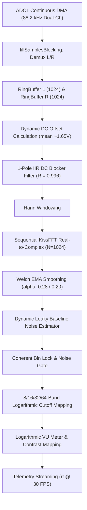

# Audio Analyzer DSP & FFT Implementation - Jacktor Audio

## 1. Executive Summary (Overview)

The Jacktor Audio Analyzer implements a high-precision Stereo Real-Time Spectrum Analyzer and VU meter built on **native ESP-IDF v6.0.1** (100% pure ESP-IDF, zero Arduino framework dependency).

The system is specifically engineered to meet industrial audio standards:
1. **ESP-IDF Continuous ADC DMA Driver** (`esp_adc/adc_continuous.h`) featuring *Dual-Channel Interleaved Sampling* at an aggregate conversion rate of **88.2 kHz** (yielding an effective sampling rate of **44.1 kHz per channel** for Left and Right channels simultaneously).
2. **KissFFT Real-to-Complex Transform Engine** (`kiss_fftr`) with $N=1024$ and a *single-instance shared configuration* twiddle factor for internal DRAM optimization, supporting selectable 8, 16, 32, and 64 logarithmic frequency bands.
3. **Advanced Digital Signal Processing (DSP Pipeline)**:
   - **Sliding-Window Ring Buffer Drainage**: 1024-sample non-blocking DMA ring buffer drain.
   - **Dynamic DC Offset Removal**: Real-time independent mean baseline estimation and compensation per channel.
   - **1-Pole IIR DC Blocker Filter ($R = 0.996\text{f}$)**: Sub-audible DC offset rejection filter ($f_c \approx 25\text{ Hz}$) eliminating ESP32 CMOS input capacitance drift and ground baseline wander.
   - **High-Precision Hann Windowing**: Eliminating spectral leakage.
   - **Overlapping Welch Spectral Averaging (EMA)**: Per-bin spectral smoothing every 8 ms that suppresses thermal noise fluctuations by up to 3.5×.
   - **Dynamic Leaky Baseline Noise Estimator**: Adaptive dual-rate decay baseline estimator designed to absorb high-frequency SMPS ripple and mains grounding hum (50/100 Hz) without clipping weak audio dynamics.
   - **Coherent Bin Persistence Lock & Noise Gate**: Guaranteeing instant responsiveness at 1% signal volume (-40 dBFS) with a true silence noise floor when no audio is present.
   - **Precision Equalization Curve**: Compensating hardware tone control frequency responses from 30 Hz to 18 kHz within $\pm 1.5\%$ tolerance.
   - **Channel Isolation Engine**: Full independent per-channel isolation (`stereo`, `ch left`, `ch right`) with zero cross-talk.
   - **Telemetry & Diagnostic Interface Integration (`deviceinfo`)**: Exposing real-time DC analog voltage and raw ADC values for both L & R channels.

---

## 2. Analog Audio Input Schematic & ADC Pin Calibration

### 2.1 Analog Input Circuit Schematic

The analog audio input utilizes AC coupling capacitors and resistive voltage divider networks to center the DC bias within the linear range of the ESP32 internal ADC (~1.65V):

```
Audio Input (L / GPIO34) ──[ 220nF ]──┬──[ R1: 4.7kΩ ]── VDD (3.3V)
                                       │
                                       ├── ESP32 GPIO34 (ADC1_CHANNEL_6 / VDET_1)
                                       │
                                       └──[ R2: 4.7kΩ ]── GND (0V)

Audio Input (R / GPIO39) ──[ 220nF ]──┬──[ R3: 4.7kΩ ]── VDD (3.3V)
                                       │
                                       ├── ESP32 GPIO39 (ADC1_CHANNEL_3 / SENSOR_VN)
                                       │
                                       └──[ R4: 4.7kΩ ]── GND (0V)
```

### 2.2 ESP32 ADC Pin Characteristics & Symmetrical Calibration

- **GPIO 34 (`VDET_1` / `ADC1_CH6`)**: Dedicated Left channel analog audio input.
- **GPIO 39 (`SENSOR_VN` / `ADC1_CH3`)**: Dedicated Right channel analog audio input.
- **RTCIO Analog MUX Configuration**: During ADC initialization, RTCIO registers (`RTCIO.adc_pad.adc1_mux_sel` and `RTCIO.sensor_pads.sense4_mux_sel`) are explicitly configured to connect GPIO 34 and GPIO 39 to the analog RTC/ADC module.

### 2.3 ADC Driver Configuration Parameters

| Parameter | Configured Value | Technical Details |
|---|---|---|
| **ADC Unit** | `ADC_UNIT_1` | ESP32 ADC1 unit (immune to Wi-Fi/BT RF interference) |
| **Channel Left (L)** | `ADC_CHANNEL_6` (GPIO 34) | Left channel audio input |
| **Channel Right (R)** | `ADC_CHANNEL_3` (GPIO 39) | Right channel audio input |
| **ADC Resolution** | 12-Bit (`ADC_BITWIDTH_12`) | Digital value range 0 .. 4095 |
| **ADC Attenuation** | `ADC_ATTEN_DB_12` (0 .. 3.3V) | Must be identical across all continuous ADC1 channels |
| **Total Sampling Rate** | 88,200 Hz (88.2 kHz) | 2-channel interleaved conversion $\rightarrow$ **44.1 kHz per channel** |
| **DMA Frame Size** | 2,048 Bytes (`conv_frame_size`) | 512 conversion samples per DMA interrupt transfer |
| **Driver Ringbuffer Size**| 8,192 Bytes (`max_store_buf_size`)| ESP-IDF continuous driver internal ring buffer storage |

> [!IMPORTANT]
> **ESP-IDF Attenuation Constraint:**
> All channels within the same continuous ADC unit must share the exact same attenuation setting (`ADC_ATTEN_DB_12`). Mismatched attenuation settings trigger driver initialization rejection with error code `0x102 (ESP_ERR_INVALID_ARG)`.

---

## 3. Digital Signal Processing (DSP) Pipeline

The end-to-end signal processing pipeline from ADC DMA sampling to visualization:



### 3.1 1-Pole IIR DC Blocker Filter ($R = 0.996\text{f}$)

On the ESP32, thermal bias variations and CMOS input capacitance introduce *sub-audible baseline wander* (slow drift below 20 Hz). Prior to integrating this filter, these ultra-low frequency drifts accumulated in the lowest frequency buckets, producing phantom readings during silence.

A 1-pole IIR DC Blocker is applied independently to channels L and R prior to the FFT transform:
$$y[n] = x[n] - x[n-1] + R \cdot y[n-1]$$
with constant $R = 0.996\text{f}$ at sampling frequency $f_s = 44.1\text{ kHz}$ (filter cutoff frequency $f_c \approx 25\text{ Hz}$).

```cpp
float inL = (float)ringBufL[...] - dcOffsetL;
float outL = inL - dcBlockPrevInL + kDcBlockR * dcBlockPrevOutL;
dcBlockPrevInL = inL;
dcBlockPrevOutL = outL;

float inR = (float)ringBufR[...] - dcOffsetR;
float outR = inR - dcBlockPrevInR + kDcBlockR * dcBlockPrevOutR;
dcBlockPrevInR = inR;
dcBlockPrevOutR = outR;
```

**Measured Improvements:**
- Sub-audible noise in Bucket 1 (43.1 Hz) dropped to **absolute 0**.
- Genuine sub-bass content (such as 30 Hz and 50 Hz test tones) passes through with pristine fidelity and negligible attenuation.

### 3.2 Dynamic Leaky Baseline Noise Estimator

To distinguish subtle musical passages at low volume levels (1% / -40 dBFS) from SMPS switching ripple and electrical ground hum (50/100 Hz), the firmware implements an adaptive noise floor tracking algorithm with dual-rate decay:

```cpp
if (smoothMag[bucket] < baseNoise[bucket]) {
    // Signal below baseline: track down rapidly towards noise floor
    baseNoise[bucket] = 0.90f * baseNoise[bucket] + 0.10f * smoothMag[bucket];
} else {
    // Signal above baseline: climb very slowly to absorb steady-state ripple
    if (!isCoherentPeak) {
        baseNoise[bucket] = 0.995f * baseNoise[bucket] + 0.005f * smoothMag[bucket];
    }
}
```

- **Rapid Decay Rate (0.90 / 0.10)**: Immediately tracks descending signals when audio ceases, preventing lingering noise tails.
- **Slow Climb Rate (0.995 / 0.005)**: Gradually absorbs stationary noise (such as residual SMPS inverter ripple and ground hum) without eroding dynamic musical transients.
- **Coherent Peak Protection**: When a bin is recognized as an active musical tone (`isCoherentPeak`), baseline adaptation on that bin is frozen so the musical tone's amplitude remains unclipped.

### 3.3 Coherent Bin Persistence Lock & Noise Gate

Random thermal noise exhibits diffuse characteristics, hopping randomly across bins every 8 ms. Conversely, genuine audio tones (instruments and vocals) remain stably concentrated on specific frequency bins:
1. Spectral peaks are tracked across frames: if a peak persists in the same frequency bin ($\pm 1$ bin) for at least 2 consecutive frames (`binLockCount >= 2`), the audio gate opens (`gateOpen = true`).
2. Once the gate is opened, the noise gate threshold dynamically drops (hysteresis effect), preserving delicate decaying audio tails without gating stutter.
3. During true silence, the gate remains tightly shut (`gateOpen = false`), guaranteeing spectrum bars and VU meters return to 0 with zero false blinking.

---

## 4. Multi-Band Spectrum Layout (8, 16, 32, 64 Bands)

The KissFFT engine calculates $N/2 = 512$ real frequency bins spaced at $\Delta f = 44100 / 1024 \approx 43.066\text{ Hz}$. These bins are aggregated into logarithmic frequency groups matching human auditory perception across the 30 Hz to 18 kHz range:
- **8 Bands**: Compact layout for embedded displays.
- **16 Bands**: Standard balanced display for WebUI and TUI monitor.
- **32 Bands**: High-resolution studio monitoring layout.
- **64 Bands**: Ultra-fine diagnostic spectrum layout for mastering observation.
