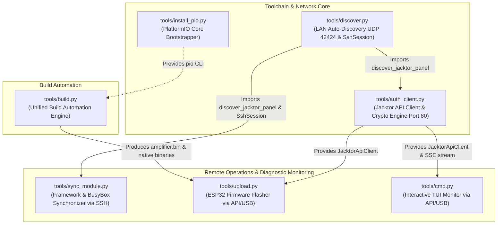

# Jacktor Audio - Developer Tools & Utilities

This directory contains the automation build engines, interactive telemetry TUI monitors, firmware flashers, and network synchronization utilities for the **Jacktor Audio** ecosystem.

---

## 1. Tool Summary

| Tool | Target Environment | Description |
| :--- | :--- | :--- |
| **[`build.py`](build.py)** | Linux Host | **Unified Project Build Engine**: Compiles the KPM kernel driver (`usb-serial.kpm`), all ARM64 native binaries ([`panel/realme-bengal/bin/`](../panel/realme-bengal/bin/): `jacktor-api`, `serial-bridge`, `esputil`, `socat`, etc.), ESP32 firmware (`amplifier.bin`), and packages the Android root framework module (`jacktor-framework.zip`) into `/build/`. |
| **[`auth_client.py`](auth_client.py)** | Linux, macOS, Windows | **Jacktor API Client & Crypto Engine**: High-performance HTTP client for Jacktor API (Port 80) with machine-unique encrypted credential storage (`tools/config/credentials.enc`), LAN discovery, real-time SSE telemetry streaming, firmware uploading, and remote flashing control. |
| **[`cmd.py`](cmd.py)** | Linux, macOS, Windows | **Interactive 3-Zone Curses TUI Monitor**: 30 Hz telemetry console, Dual Stereo 16/32/64-band KissFFT Spectrum Analyzer (`ana-page`), segmented LED VU meters, direct Jacktor API streaming (`ApiSerialBridge` Port 80) or local USB, and live amplifier command dispatching. |
| **[`upload.py`](upload.py)** | Linux, macOS, Windows | **Firmware Flasher**: Compiles and flashes ESP32 Amplifier firmware either via **Direct USB** or **over Jacktor API (Port 80)** at 921,600 bps with real-time byte-level progress streaming, coordinating device locks and `serial-bridge` lifecycle automatically. |
| **[`sync_module.py`](sync_module.py)** | Host PC (via SSH) | **Unified Framework & BusyBox Synchronizer**: Differential rsync (with SCP fallback) pushing modified module assets (WebUI, configs, daemons, system overlays) to `/data/adb/modules/jacktor-audio-framework/`, excluding `META-INF`, restarting `httpd` on changes, and managing BusyBox NDK symlinks (`--busybox`). |
| **[`discover.py`](discover.py)** | Host PC | **LAN Auto-Discovery Engine**: Detects the Android panel automatically via UDP broadcast beacons (Port 42424) and multi-subnet sweeps (HTTP Port 80), providing authenticated OpenSSH sessions (`SshSession`). |
| **[`install_pio.py`](install_pio.py)** | Linux & Windows | **PlatformIO Core Installer**: Standalone script downloading official `get-platformio.py` and setting up the PlatformIO CLI toolchain. |
| **[`run.sh`](run.sh)** | Linux / macOS | **Console Launcher**: Shell shortcut to launch `cmd.py`. |

---

## 2. Port & Network Service Architecture

The Jacktor Audio platform operates on dedicated, non-overlapping ports:

```
+-------------------------------------------------------------------------+
|                         JACKTOR NETWORK SERVICES                        |
+------+-----------+-------------------------+----------------------------+
| Port | Protocol  | Daemon / Service        | Purpose                    |
+------+-----------+-------------------------+----------------------------+
| 80   | HTTP(S)   | BusyBox httpd           | Unified WebUI (webroot/)   |
|      |           | + CGI (/cgi-bin/jacktor-api) | & REST/SSE Telemetry API |
| 7777 | TCP       | serial-bridge (socat)   | Raw UART Multiplexer       |
| 22   | SSH       | opensshd (sshd)         | System Administration      |
| 42424| UDP       | busybox nc (Beacon)     | Subnet Auto-Discovery     |
+------+-----------+-------------------------+----------------------------+
```

> [!NOTE]
> **No Port Collision**: The WebUI (static HTML/CSS/JS) and the Jacktor API (`/cgi-bin/jacktor-api`) share **Port 80** seamlessly through standard HTTP server CGI gateway architecture. There is no secondary HTTP daemon, eliminating port contention completely.

---

## 3. Python Dependency Graph



---

## 4. Unified Build Engine ([`build.py`](build.py))

`build.py` orchestrates the compilation of all ecosystem components into `/build/`:
1. **[1/4] KernelPatch Module Driver**: `panel/realme-bengal/kpm/usb-serial/` -> `build/usb-serial.kpm`
2. **[2/4] Native ARM64 System Binaries**: All tools in `panel/realme-bengal/bin/` (`jacktor-api`, `serial-bridge`, `esputil`, `socat`, `amp-status`, etc.) compiled via Musl AArch64 toolchain, installed to module `system/bin/`, and mirrored to `/build/`.
3. **[3/4] Amplifier Firmware**: `firmware/amplifier/` -> `build/amplifier.bin` (via PlatformIO).
4. **[4/4] Android System Module**: `panel/realme-bengal/modul/jacktor-audio-framework/` -> `build/jacktor-framework.zip`.

### CLI Usage:
```bash
# Build complete project:
python3 tools/build.py

# Clean rebuild:
python3 tools/build.py --clean

# Build specific components:
python3 tools/build.py --kpm-only      # Only usb-serial.kpm driver
python3 tools/build.py --bin-only      # All native ARM64 system binaries
python3 tools/build.py --api-only      # Only jacktor-api binary
python3 tools/build.py --esputil-only  # Only esputil ARM64 binary
python3 tools/build.py --bridge-only   # Only serial-bridge ARM64 binary
python3 tools/build.py --fw-only       # Only ESP32 amplifier.bin firmware
python3 tools/build.py --module-only   # Only Android framework module ZIP
```

---

## 5. TUI Telemetry & Diagnostic Monitor ([`cmd.py`](cmd.py))

An interactive 3-zone curses console monitor optimized for standard and mobile/Termux screens:
- **Fixed Header**: Power status (ON/OFF), SMPS voltage, temperatures, rail health, and TX/RX data rates.
- **Scrollable Log Area**: Auto-scroll of live TX, RX, and ACK frames.
- **Clean Segmented VU Meter**: Footer stereo VU meter with discrete segment blocks (`■`) and independent Left vs Right channel rendering without distracting vertical divider lines.
- **Audio Spectrum Analyzer (`ana-page`)**: 16/32/64-band KissFFT real-time visualizer with gravity decay, peak-hold decay, and stereo balance monitoring. Only active in amplifier runtime mode.
- **Direct Jacktor API Streaming (`ApiSerialBridge`)**: Streams telemetry over HTTP Server-Sent Events (SSE) `/cgi-bin/jacktor-api?action=stream` at Port 80, eliminating port lock contention with automatic reconnection.
- **Explicit Connection Targets**:
  - `1. USB (Direct USB serial) [DEFAULT]`
  - `2. Panel (Android Panel via High-Speed Jacktor API Port 80)`

### CLI Usage:
```bash
# Interactive menu (Default: 1 = USB):
python3 tools/cmd.py

# Direct selection via CLI argument:
python3 tools/cmd.py usb                # Connects to local USB serial port
python3 tools/cmd.py panel              # Connects to Android Panel via Jacktor API (Port 80)

# Direct connection via explicit address/device:
python3 tools/cmd.py /dev/ttyUSB0
```

---

## 6. Firmware Flasher ([`upload.py`](upload.py))

Compiles and flashes the ESP32 firmware strictly at 921,600 bps with safety protections:
- **Explicit Target Selection**:
  - `1. USB (Direct USB serial port) [DEFAULT]`
  - `2. Panel (Android Panel via High-Speed Jacktor API: Upload & Real-Time Flash @ 921600)`
- **Build & Upload Flexibility**:
  - Default: Automatically compiles firmware, then uploads to chosen target.
  - `--build-only` (`-b`): Compile firmware only without uploading.
  - `--upload-only` (`-u`): Upload pre-built binaries without recompiling.
- **Strict 921,600 bps Baud Rate**: Flashing is performed strictly at 921,600 bps with 100% reliable ROM sync via optimized hardware auto-reset timing in `esputil`.
- **Real-Time Progress Display**: Streams flash progress byte-by-byte and percentage in real-time identical to a direct local USB flash.
- **Automatic Bridge & Lock Coordination**: The Jacktor API automatically holds `/data/local/tmp/jacktor_flashing.lock`, suspends `serial-bridge`, flashes via `esputil`, and restarts `serial-bridge` once complete.

### CLI Usage:
```bash
# Interactive menu (Default: 1 = USB, builds then uploads):
python3 tools/upload.py

# Build firmware only:
python3 tools/upload.py --build-only
python3 tools/upload.py -b

# Upload only without recompiling:
python3 tools/upload.py --upload-only
python3 tools/upload.py -u

# Flashing via Android Panel (High-Speed Jacktor API @ 921600):
python3 tools/upload.py panel
python3 tools/upload.py panel --upload-only

# Flashing via direct local USB port:
python3 tools/upload.py usb
python3 tools/upload.py usb --upload-only
```

---

## 7. Live Framework & BusyBox Synchronizer ([`sync_module.py`](sync_module.py))

Unifies differential file synchronization and BusyBox NDK applet management for active development without flashing ZIPs or rebooting:
- Pushes only modified files to `/data/adb/modules/jacktor-audio-framework/`.
- Excludes `META-INF` installer files from being synced to live device.
- Automatic fallback from rsync to streaming SCP if rsync is not available on the target device.
- Re-generates BusyBox applet symlinks dynamically without colliding with ROM binaries in `/system/bin`.
- Selectively restarts the Port 80 WebUI daemon (`httpd`) only when `webroot/` or `httpd.conf` files change, gracefully handling streaming instances.

### CLI Usage:
```bash
# Synchronize modified module files:
python3 tools/sync_module.py [PANEL_IP]

# Force full re-sync of all module files:
python3 tools/sync_module.py [PANEL_IP] --force

# Sync BusyBox NDK binary and re-generate symlinks:
python3 tools/sync_module.py [PANEL_IP] --busybox
```
